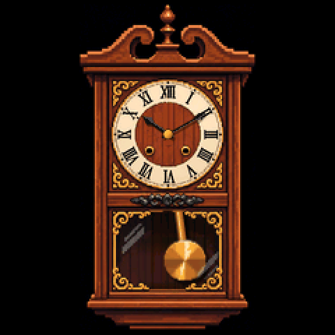
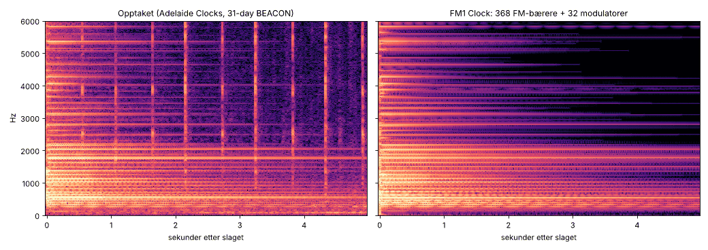

# FM1 Clock for M-VAVE FM-1

Den mest ubrukelige firmwaren til FM-1: en pendelklokke. Den går, pendelen svinger, og den tikker i begge
ytterpunktene av svingen, hvert halve sekund. Den slår timene (og ett slag på halvtimen) på en FM-gong som er
tilpasset et opptak av en ekte 31-dagers veggklokke med spiralgong. Hele brikken brukes på tikk-takk og gong.
En Dinghy 0.5-app, i samme familie som [VaveHero](https://github.com/joakimskurk/fm1vavehero),
[RoboSeq](https://github.com/joakimskurk/fm1roboseq) og [SkurkyMello](https://github.com/joakimskurk/fm1mello).

<p align="center"></p>

> **Status: 0.1 under arbeid.** Bygget i CI, testet på verten og målt i fm1-emu, men ikke prøvd på et ekte FM-1
> ennå.

## Bruk

| | |
|---|---|
| SELECT | Minuttviseren, ett minutt per hakk. Dreier du forbi hel eller halv time, slår klokka den når du slipper, som en ekte klokke. |
| ALGORITHM | Timeviseren |
| SEL | Til nærmeste hele minutt: trykk når en klokke du stoler på viser :00 |
| PLAY | Slår siste hele time på nytt (repetisjonsverk) |
| FX | Slagverket av og på. FX lyser når klokka er stille |
| HOME | Klokkeslettet med tall ved siden av klokka, av og på |
| SEQ | Hvor mange FM-operatorer brikken kjører akkurat nå, og hvor mye av lydtiden de tar |
| KNOB 1, KNOB 2 | Nivået på tikkene og på gongen, 0–200 % av opptaket (lagres) |
| MIDI | CC 20 timer, CC 21 minutter, CC 22 sekunder, på hvilken som helst kanal. Klokka stilles når sekundene kommer. `python3 tools/settime.py` sender datamaskinens tid. |
| Tangentene | Lyset følger pendelen (på SMK-37 gjør padsene det) |

Klokka starter på 10:10. Tiden går tapt når FM-1 slås av, som når en klokke stopper, så den må stilles.
Tiden holdes mot 24 MHz-krystallen (TIMER4), ikke mot lydklokka. Tikket legges på riktig frame i lydblokka.
Pendelen er en halvsekundspendel: én hel svingning per sekund og et tikk i hvert ytterpunkt. Pendelen i
designet er ca. 24 cm fra opphenget til loddet, og en halvsekundspendel er 24,8 cm.

## Lyden

Opptaket er *Clock Strike Chime Sound 31x Day BEACON Pendulum Wall Item 1125* (Adelaide Clocks). Det ligger
ikke i dette repoet. Bare målingene ligger her (`tools/ref_model.json`, `tests/ref/features.json`), laget av
`tools/analyze_ref.py`.

- **Gongen** er en spiralgong. Partialene kommer i to nesten like rekker, 267/270, 328/331, 394/398, 466/472,
  543/551 Hz og videre, der √f øker jevnt med ca. 1,76, slik bøyemodene i en stiv tråd gjør. De doble partialene
  gir svevningen. Analysen finner 742 moder mellom 130 Hz og 15 kHz (matrix pencil i 70 Hz brede bånd). Hver mode
  blir en FM-bærer med sin frekvens, amplitude, fase og utklingning. De 32 sterkeste får hver sin modulator, og
  modulatorforhold, indeks og indeksfall er søkt fram slik at de første 100 ms, selve hammerslaget, får samme
  båndenergi som opptaket. Modulatorene flytter energi fra hver mode ut i sidebånd, og det er klangen i slaget.
- **Slagverket:** 1,192 s mellom slagene. Det første slaget er sterkest, så 0,85 og deretter ca. 0,53, som i
  opptaket. Et utløserklikk kommer 40 ms før hvert slag. Et nytt slag legges oppå en gong som fortsatt ringer.
- **Tikk og takk** er to lyder med 64 sinusoperatorer hver: de sterkeste toppene i spekteret og fyll mellom
  dem. Hvert tredjedels-oktavbånd har to utklingninger (et raskt fall og så en hale i verket og kassa), og
  anslaget stiger over 4–5,5 ms. Opptaket har et svakt etterklikk 115 ms etter takket; det er tatt bort, så det er ett klikk på hver side. Hvert tikk
  starter operatorene med tilfeldig fase og litt variasjon i tone og nivå, så ingen to tikk er like. Tikket
  kommer litt fra venstre og takket litt fra høyre, der pendelen er.

Avvik fra opptaket, målt som båndenergi i tredjedels-oktaver over tid (`tests/clk/parity.py`, RMS over båndene
som ligger over støyen i opptaket):

| | 0–20 ms | 20–50 | 50–100 | 0,1–0,2 s | 0,2–0,4 | 0,4–0,8 | 0,8–1,6 | 1,6–3,2 | 3,2–5 |
|---|---|---|---|---|---|---|---|---|---|
| Slag, 257 bærere (som i fm1-emu) | 0,5 dB | 1,2 | 0,7 | 0,7 | 0,7 | 1,3 | 1,3 | 0,7 | 1,8 |

| | −2–4 ms | 4–10 | 10–20 | 20–35 |
|---|---|---|---|---|
| Tikk (snitt av 24) | 1,3 dB | 0,9 | 1,2 | 1,2 |
| Takk | 1,0 | 1,0 | 1,2 | 1,2 |

<p align="center"></p>

Mer i [docs/lyd.md](docs/lyd.md).

## Hele brikken

Alle operatorene regnes ut i hver frame, enten de klinger eller ikke. En guvernør måler hver lydblokk mot
krystallen og regner ut så mange av gongens bærere (de sterkeste først) som får plass i 78 % av tiden en blokk
har. Resten av gongen klinger ut i det stille og tas inn igjen der den ville ha vært, hvis det blir plass.
Brikken er dermed full hele tiden, også mellom slagene, og aldri fullere enn det. På et ekte FM-1 tilpasser den
seg det brikken faktisk klarer. SEQ viser tallet på skjermen.

**Målt i fm1-emu** (den ekte pakken, CI): guvernøren regner ut 257 av gongens 742 bærere. Med de 32
modulatorene og de 128 tikkoperatorene blir det 417 FM-operatorer i 44,1 kHz. Lydmotoren tar 77 % av hver blokk
(78 % i den verste), og alle avbruddene tar 75 % av brikken. Resten går til pendelen (50 bilder i sekundet),
viserne, USB og panelet. Slaget er innenfor 1,8 dB av opptaket med 257 bærere, like nær som med alle 742 (de
tar 99,8 % av energien), og innenfor 1,9 dB med 160.

## Bygg og test

```sh
make test          # klokkas vertstester: lyden mot opptaket, tiden, slagene, skjermen; uten FM-1
make fw            # build/fm1clock.fwsc: krever JieLis verktøykjede og AC79-SDK-en (docs/DINGHY_README.md)
make emu           # pakken i fm1-emu: andel av brikken, tikk hvert halve sekund, slag, pendel
```

GitHub Actions bygger `.fwsc`-pakken ved hver push via zvenson/fm1-build, kjører testene og kjører pakken i
fm1-emu (`.github/workflows/build.yml`). Pakken heter `FM-1_94N`, der N er mindreversjonen, og 0 er en
utviklerbygging.

**Prøv den uten FM-1:** last ned `packages` fra en bygging under *Actions* på GitHub, pakk ut `fm1clock.fwsc`
og åpne den i [fm1-emu](https://joakimeriksson.github.io/fm1-emu/) i nettleseren.

## Innhold

| | |
|---|---|
| [firmware/src/fm1clock.c](firmware/src/fm1clock.c) | Appen: tiden, slagverket, panelet, MIDI, innstillingene |
| [firmware/src/clk_engine.h](firmware/src/clk_engine.h) | Lydmotoren: FM-gongen, tikkbankene, guvernøren |
| [firmware/src/clk_draw.h](firmware/src/clk_draw.h) | Bildene: viserne, pendelen bak glasset |
| [tools/analyze_ref.py](tools/analyze_ref.py) | Måler opptaket: modene, slagtoget, tikkene |
| [tools/fit_model.py](tools/fit_model.py) | Tilpasser FM-anslaget og tikkbankene til målingene: `tools/clk_model.json` |
| [tools/gen_tables.py](tools/gen_tables.py) | Modellen som heltallstabeller: `firmware/gen/clk_tables.h` |
| [tools/gen_art.py](tools/gen_art.py) | Designet uten visere og pendel, vinduets lag og loddet: `firmware/gen/clk_art.h` |
| [tests/run_clock.sh](tests/run_clock.sh) | Vertstestene |
| [tools/emu_check.sh](tools/emu_check.sh) | Pakken i fm1-emu |
| [assets/design.png](assets/design.png) | Designet |
| [PLATFORM.md](PLATFORM.md) | Hvilken Dinghy, og hva som er endret fra den |
| [docs/API.md](docs/API.md), [docs/RULES.md](docs/RULES.md) | Dinghys API og brikkens regler (fra Dinghy) |

Firmwaren er fri programvare under GPL-3.0 ([LICENSE](LICENSE), hvem som har laget hva står i
[LICENSING.md](LICENSING.md)). Dette er et fanprosjekt og ikke et offisielt M-VAVE-produkt.
