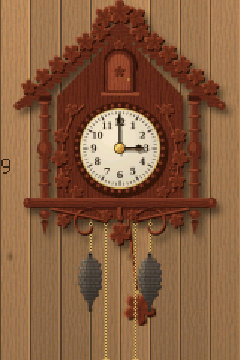
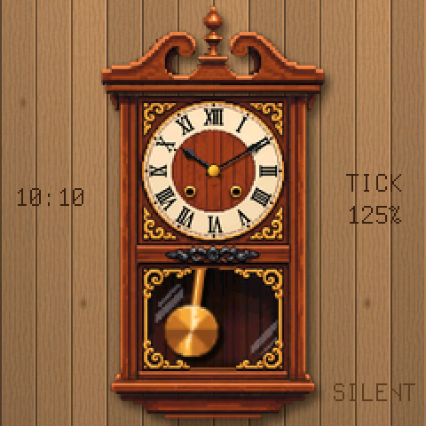
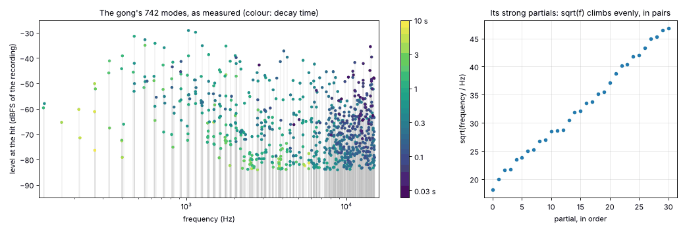
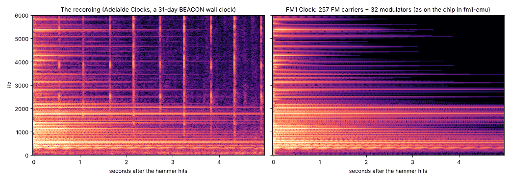

# FM1 Clock for the M-VAVE FM-1

I predict that before we know it, the FM-1 will be an almost forgotten treasure. So I have made something that right
now looks completely useless, but may one day turn out to be its only useful function: a clock! And not just any
clock. The bell of this clock is the sound of a real 31-day BEACON pendulum wall clock striking its coil gong, taken
apart into 742 vibrating modes, each one measured for its pitch, its loudness, its phase and how long it rings, and
built up again as an FM synthesiser of over four hundred operators. That synthesiser keeps the whole chip busy, every
frame, all day long, whether it is striking or not. The tick and the tock are measured the same way and rebuilt from
64 operators each. The pendulum swings, it ticks at each end of its swing, and the clock keeps real time.

And since one useless clock is not enough, turn the ALGORITHM knob and there is a second one: **a cuckoo clock** of
its own design, a little painted chalet. On the hour its door swings open, the bird comes out of the dark and calls
the hours on two FM pipes fitted to a real Black Forest cuckoo clock, bowing to each call, while a wire gong of 681
modes is struck under it. Its pendulum beats faster, and its pine-cone weights sink on their chains through the day.

<p align="center">
</p>

> **Status: 0.1, in progress.** The FM-1 package is built in CI and run there in fm1-emu, the FM-1 emulator. The
> sound is tested against the recording on a computer. It has not yet been tried on a real FM-1.

It is a [Dinghy 0.5](https://github.com/zvenson/dinghy) app, from the same family as
[VaveHero](https://github.com/joakimskurk/fm1vavehero), [RoboSeq](https://github.com/joakimskurk/fm1roboseq) and
[SkurkyMello](https://github.com/joakimskurk/fm1mello).

## Contents

- [What it does](#what-it-does)
- [Using it](#using-it)
- [How it keeps time](#how-it-keeps-time)
- [The sound](#the-sound)
  - [The recording](#the-recording)
  - [The coil gong](#the-coil-gong)
  - [Measuring the modes](#measuring-the-modes)
  - [From modes to FM](#from-modes-to-fm)
  - [The strike train](#the-strike-train)
  - [The tick and the tock](#the-tick-and-the-tock)
  - [How close it is](#how-close-it-is)
- [The cuckoo clock](#the-cuckoo-clock)
  - [Its own design](#its-own-design)
  - [What moves](#what-moves)
  - [The chains and the weights: not a counterweight](#the-chains-and-the-weights-not-a-counterweight)
  - [Its sound](#its-sound)
  - [How close the cuckoo is](#how-close-the-cuckoo-is)
- [Using the whole chip](#using-the-whole-chip)
- [The engine, in integers](#the-engine-in-integers)
- [The picture](#the-picture)
- [Build, test, try, install](#build-test-try-install)
- [Making the tables again](#making-the-tables-again)
- [What is where](#what-is-where)
- [Platform, identity, licence and credits](#platform-identity-licence-and-credits)

## What it does

- **Two clocks, one time.** The wall clock and the cuckoo clock (ALGORITHM switches between them) show the same
  time. The FM-1 remembers which one it was showing.
- **It keeps time.** It counts the FM-1's 24 MHz crystal, not the audio clock.
- **The pendulum swings and ticks.** It is a half-second pendulum: one full swing to and fro per second, and one
  click at each end of the swing, so a click every half second. The *tick* comes from the left, the *tock* from the
  right, as the pendulum is there.
- **It strikes the hours** on the gong: one blow at one o'clock, twelve at twelve, 1.19 s apart, every blow as hard
  as the first. **One blow at the half hour.**
- **It behaves like a real striking clock.** Turn the minute hand forward past the hour and it strikes that hour
  when you let go. A repeat button strikes the last hour again. A switch silences the strike.
- **The cuckoo clock calls the hours**: one call at one o'clock, twelve at twelve, a call every 0.665 s, and one call
  at the half hour. Its door opens before the first call and shuts after the last; the bird comes out, bows and
  calls, and goes in again. Its weights go down through the day, and ENV winds it.
- **The keys' lights** follow the pendulum, or flash with each blow on the hour (and, with the strike switched off,
  still flash the hour's count: a silent clock you can read from across the room), or stay off. GLO chooses.
  Playing the keys does nothing: this is a clock.
- **The screen** is the clock from the design, with hands and a pendulum that the firmware draws over it: the hands
  smooth-edged, the pendulum behind the glass with the glass's reflections over it and its own shadow on the wood
  behind it.

## Using it

| Control | What it does |
|---|---|
| **ALGORITHM** (encoder) | The clock: the wall clock or the cuckoo clock (each turn changes it). The time goes on; a strike that is running stops. |
| **SELECT** (encoder) | Turns the minute hand, one minute a detent. Turned forward past the hour or the half hour, the clock strikes it half a second after you stop turning (as a real clock does when you move its hands). Turned back, it does not strike. |
| **PRESETS** (encoder) | Turns the hour hand, an hour a detent. |
| **SEL** | Rounds the time to the nearest whole minute. Press it when a clock you trust shows :00 seconds. |
| **PLAY** | Strikes (or calls) the last full hour again (a *repeater*, as some old clocks have: useful in the dark). It strikes even when the strike is switched off. PLAY is lit while a strike runs. |
| **FX** | The strike on or off. FX is lit, and the screen says SILENT, while it is off. The ticking goes on. The cuckoo's door stays shut, as with a real one's silencing lever. |
| **GLO** | The keys' lights, in turn: **SWING** (the white key under the pendulum's bob is lit and moves with it), **HOURS** (all the keys flash with each blow of the hour and the half hour; with the strike off they still flash the hour's count, at the hour only), **OFF**. The screen says which for two seconds. |
| **ENV** | (The cuckoo clock) winds it: the rings are pulled down and the weights go up, the click wheel clicking. Nobody has to: when a weight reaches the bottom, someone winds it. |
| **HOME** | The time as digits to the left of the clock, on or off. |
| **SEQ** | How many FM operators the chip is running right now, and how much of the audio's time they take (top right). |
| **KNOB 1** | The ticks' level, 0 to 200 % of the recording's, in steps of 6.25 %. |
| **KNOB 2** | The strike's level, the same way: the wall clock's gong, or the cuckoo's call (its gong and its pipes). |
| **MASTER** | The volume of everything (the platform's). |
| **MIDI in** (USB or the TRS jack) | Control change 20 sets the hours (0–23), 21 the minutes (0–59), 22 the seconds (0–59), on any channel. The time is set when the seconds arrive. `tools/settime.py` sends the computer's time, the seconds the moment that second begins. |
| **The keys** | Nothing. Their lights do what GLO says. (On the M-Vave SMK-37, which has no key lights, the pads do it in brass.) |

<p align="center"></p>

**At power-on** the clock shows 10:10 (the time watchmakers set their hands to for photographs) and shows it as
digits for three seconds. The FM-1 has no battery-backed clock, so the time is lost when it is switched off, as a
pendulum clock stops when nobody winds it. Set it with SELECT and PRESETS, or from a computer:

```sh
pip3 install mido python-rtmidi
python3 tools/settime.py            # finds the MIDI port with "FM-1" in its name; --list shows the ports
```

**The settings are kept**: the clock, the two levels, the strike switch, the keys' lights, the digits and the
operator display are saved in the FM-1's flash, two seconds after you change one, and only when the gong is still
and between two ticks. Writing the
flash stops the sound for about 50 ms, and at that moment there is nothing to stop.

## How it keeps time

- **The time base is the crystal.** The FM-1's TIMER4 counts the 24 MHz crystal. Every 5.8 ms the audio interrupt
  takes what it has counted and turns it into half seconds (12,000,000 crystal ticks each). It does not count audio
  frames, so the clock is exactly as good as the crystal, typically within a couple of seconds a day.
- **Each tick lands on its exact frame.** When a half second falls inside the 256 frames the interrupt is about to
  render, it works out on which frame it falls (44,100 / 24,000,000 = 147 / 80,000 frames per crystal tick) and the
  tick starts there. If a half second ever slips between two blocks, its tick is played at the start of the next
  one: no tick is lost.
- **The pendulum follows the same clock.** Its angle is 8° × cos(π × half seconds since power-on), so it is at one
  end of its swing exactly when a tick sounds. The main loop reads the same counters (through a sequence number, so
  it never sees them half updated) and adds what the crystal has counted since.
- **The time of day** is the half seconds since power-on plus an offset that setting the hands changes. The
  pendulum never jumps when you set the time, because the offset is always whole half seconds; setting it over MIDI
  or with SEL is therefore exact to half a second.
- **Why half a second.** A pendulum that beats half seconds (a full swing to and fro each second) is 24.8 cm long.
  The pendulum in the design hangs about 24 cm from its suspension to the centre of its bob, if the clock is about
  60 cm tall: the design was already a half-second clock.
- **The cuckoo's beat** is its own: 0.4286 s, as measured in its recording, the beat of a pendulum 18 cm long. The
  interrupt counts it from the same crystal, beside the half seconds, from the moment the cuckoo clock is chosen
  (its pendulum starts at one end), and puts each of its ticks on its frame the same way. The time of day, and so
  the hour and its strike, still come from the half seconds.

## The sound

Everything you hear is synthesised. No sample of the recording is in the firmware.

### The recording

*Clock Strike Chime Sound 31x Day BEACON Pendulum Wall Item 1125*, by Adelaide Clocks: 48 kHz, mono, 43 seconds,
low-passed at about 15.5 kHz. It is not in this repository (it is not ours to share). What is here are measurements
of it (`tools/ref_model.json`, `tests/ref/features.json`), made by `tools/analyze_ref.py`.

| Time | What is in it |
|---|---|
| 0–15.5 s | The clock ticking. Its tick and tock come 0.578 s and 0.511 s apart in turn: that clock is a little out of beat. FM1 Clock ticks evenly, every 0.5 s. |
| 15.65 s | **One strike, on its own** (a half hour). This is what the gong's model is measured from. |
| 25.6–37.5 s | **Eleven strikes** (eleven o'clock), 1.192 s apart. This is what the strike train is measured from. |

### The coil gong

A wall clock's "gong" is a coil of hardened steel wire, fixed at one end in a block on the back of the case. Struck
by a hammer, the wire bends and vibrates in many modes at once, each with its own frequency, and each one dies away
at its own rate: that is the gong's sound.

The measurement shows exactly that. The strong partials come in **two nearly equal series**: 267/270 Hz, 328/331,
394/398, 466/472, 543/551, 628/637, 716/727, 810/823 and on up. A wire coiled in a spiral bends a little differently
in its two directions, so each mode comes twice, a few hertz apart, and **the two beat against each other**: the
slow shimmer you hear while the gong rings. Within each series **the square root of the frequency climbs in even
steps** (about 1.76 √Hz a partial). That is how the bending modes of a stiff bar or wire are spaced (their
frequency grows with the square of their number), and not how a string or a pipe is spaced (they grow in
whole-number steps). That is why a gong sounds like a gong and not like a note.

<p align="center"></p>

### Measuring the modes

A ringing mode is a *damped sinusoid*: a frequency, a level, a phase, and a decay (the level falls by e, about
8.7 dB, every τ seconds). The analysis finds all of them, like this:

1. **The hit.** The strike's exact moment is found in the recording (15.6503 s), and the window 0.06–5.2 s after it
   is taken: after the hammer's first crash, before the room's noise at 22 s.
2. **Bands.** For every 70 Hz from 150 Hz to 15 kHz, the signal is shifted down so that the band's centre sits at
   0 Hz (multiplied by a complex sinusoid), low-passed, and kept at only 400 samples a second. Each band is now a
   short, slow signal holding just the few modes within 35 Hz of its centre.
3. **Matrix pencil.** Each band is analysed with the *matrix pencil* method. A signal that is a sum of damped
   sinusoids has a special structure: shifted by one sample, it is the same sum with each sinusoid multiplied by a
   fixed complex number (its *pole*, which holds its frequency and its decay). The method stacks the signal into a
   matrix of shifted copies, finds the few directions that carry it (a singular value decomposition, keeping what
   is less than 45 dB under the strongest), and solves for the poles directly. Then the levels and phases follow by
   least squares. No guessing, no peak picking.
4. **What is kept.** The bands tile the spectrum, so no mode is found twice. 742 modes are kept, from 128 Hz to
   15 kHz. Many partials turn out to be **two poles at almost the same frequency with different decays**, for
   example the strongest, 551.4 Hz, falls with τ = 0.39 s and with τ = 2.1 s at once: a partial that drops quickly
   after the hit and then rings on. Both are kept.
5. **The tail.** The fit leans on the loud beginning. So afterwards, the decay times in each third of an octave are
   stretched a little (by 0.89–1.34) until the band's energy from 0.1 to 5 s matches the recording too.
6. **The ticks during the decay.** The recording keeps ticking while the gong rings. The analysis finds those ticks
   (above 8 kHz the gong is quiet after 0.2 s) and leaves them out of every measurement of the gong.

### From modes to FM

**FM synthesis** makes sound from *operators*: sine oscillators. A *carrier* is an operator you hear. A
*modulator* is an operator you do not hear: it pushes the carrier's phase back and forth. How far it pushes is the
*index*. With the index at zero the carrier is a pure sine. As the index rises, the carrier's energy spreads out
into *sidebands* above and below it, spaced by the modulator's frequency, and the sound gets brighter and harsher.
A classic FM bell uses a handful of operators at strange ratios and lets the index fall after the attack.

FM1 Clock does the same thing, at a much larger scale:

- **Every measured mode is a carrier**, at its own frequency, level, phase and decay: up to 742 carriers.
- **The 32 strongest have a modulator each.** Their index is high at the moment the hammer hits and falls within
  milliseconds, so that for an instant each of them spreads into sidebands: the crash of the hammer on the steel.
  A carrier's level may also be lifted for that moment. Each of the 32 is, in effect,

  `a · e^(−t/τ) · (1 + B·e^(−t/τI)) · sin(2πft + φ + I·e^(−t/τI) · sin(2π·r·f·t))`

  with its ratio *r* (from 0.1 to π), its index *I* (0 to 3 radians), the index's fall *τI* (4 to 60 ms) and the
  lift *B* chosen by searching (`tools/fit_model.py`: each operator in turn, every combination, three rounds), so
  that the first 100 ms have the recording's energy in every third of an octave. Before the search those first
  100 ms were 2.4 dB off on average; after it, 0.9 dB.

### The strike train

- **Timing.** The hammer strikes 1.192 s from blow to blow, as in the recording, varied by about ±1 % (±12 ms) from
  blow to blow, as a real clock's train is.
- **Strength.** Every blow is as hard as the first, varied by up to ±6 % from blow to blow. The recording's eleven
  strikes do get softer after the first two (0.85, then about 0.53 of the first, measured as the energy just after
  each blow minus the energy just before), but only because the phone recording them was moved further from the
  clock, so here they are balanced.
- **The release click.** About 40 ms before each blow there is a click: the strike train letting the hammer go. It
  is one of the tick sounds, softer.
- **A blow on a ringing gong.** A new blow adds to a gong that is still ringing. Each mode's new level is the sum of
  the old one and the new one with the phase between them unknown (|a + b| ≈ the larger + 3/8 of the smaller). If
  the gong is (almost) still, each mode starts from the phase it had in the recording, so a blow from rest is the
  recorded blow.

### The tick and the tock

The recording's 14 ticks and 14 tocks were lined up and measured separately (above 400 Hz; there is a hum in the
room below that). Each of the two sounds is rebuilt from **64 sine operators**:

- **The frequencies:** the 28 strongest peaks of its spectrum (the escapement's steel ringing, around 1.4, 1.8, 2.3,
  2.5 and 3.7 kHz), and 36 more spread from 330 Hz to 14.5 kHz to fill in between (the wooden case knocks too).
- **Two decays in every third of an octave:** the operators there take a short and a long decay in turn (the
  click falls fast, then the movement and the case ring on). Each band's two decays are picked from a grid by
  non-negative least squares against the recording's energy in that band over its first 35 ms.
- **The levels, all at once:** a window of a few milliseconds smears each operator's energy into the neighbouring
  bands, so all 64 levels are then fitted together, each operator with its own template (non-negative matrix
  factorisation updates).
- **The rise:** a tick is not instant. It rises as 1 − e^(−t/τa): τa = 4.0 ms for the tick, 5.5 ms for the tock.
- **No two alike:** each tick starts every operator at a random phase, a little off in pitch (±0.1 %) and level
  (±12 %), and the whole tick 0.92–1.04 of its level.
- **Where it comes from:** the tick is 4.6 dB louder on the left, the tock on the right.
- **One click on each side.** The recording has a softer second click 115 ms after each tock (the escape wheel
  settling). On the clock it made the tock sound double, so it is gone.

### How close it is

The engine is run on its own on a computer (`tests/clk/clk_render.c`, the firmware's own code), and its output is
measured the way the recording was: the energy in each third of an octave, 100 Hz to 16 kHz, in windows of time
after the hit, with the recording's ticks masked out and only the bands where the recording stands 6 dB over its
noise counted. The numbers are the root mean square of the differences over the bands, in dB
(`tests/clk/parity.py`).

| A strike | 0–20 ms | 20–50 | 50–100 | 0.1–0.2 s | 0.2–0.4 | 0.4–0.8 | 0.8–1.6 | 1.6–3.2 | 3.2–5 |
|---|---|---|---|---|---|---|---|---|---|
| all 742 carriers | 0.66 dB | 1.31 | 0.65 | 0.69 | 0.62 | 1.02 | 1.17 | 0.72 | 1.78 |
| 208 carriers (as on the chip) | 0.55 dB | 0.99 | 0.84 | 0.80 | 0.71 | 1.36 | 1.55 | 0.70 | 1.80 |
| 160 carriers | 0.53 dB | 0.98 | 0.94 | 1.16 | 0.86 | 1.73 | 1.59 | 0.70 | 1.86 |

| The mean of 24 | −2–4 ms | 4–10 | 10–20 | 20–35 |
|---|---|---|---|---|
| ticks | 1.31 dB | 0.93 | 1.15 | 1.23 |
| tocks | 0.95 dB | 0.96 | 1.15 | 1.16 |

A difference of 1 dB in a band is about the smallest change of loudness most people can hear.

<p align="center"></p>

## The cuckoo clock

Turn ALGORITHM and the wall clock gives way to a cuckoo clock, the other kind of clock everybody can hear in their
head. It shares the time, the panel and the engine with the wall clock; its picture, its motion and its sound are
its own.

<p align="center"></p>

### Its own design

The house is this firmware's own, drawn by code (`tools/gen_art_cuckoo.py`) and not taken from any real clock or
photograph: a painted Black Forest chalet.

- A roof of shingles on a thick edge, a scalloped barge board under them, a turned finial at the peak.
- The bird's door in the gable: an arched board with a heart cut through it and a brass knob.
- A big cream dial, 62 px across, with Arabic numerals, a minute track and a carved bezel with a brass bead. A real
  cuckoo clock's dial is small; on a 240 px screen it has to be bigger to be read. The hands are the wall clock's,
  smaller, dark on cream.
- Two windows with green slatted shutters and red geraniums in their flower boxes.
- A balcony of eighteen sawn boards, a round hole and a slot cut where every other two meet, as on the chalets of
  the Black Forest.
- A carved apron under it, scalloped, with a heart for a drop.

Everything is drawn eight times over (polygons, ellipses, and wood grain made from smoothed noise, the boards'
grain vertical, the beams' horizontal) and averaged down to the screen, so the edges are soft. The house is
stored once (138 × 166 px); what moves is drawn by the firmware from sprites made at the same time
(`firmware/gen/clk_art_cuckoo.h`).

### What moves

- **The pendulum** hangs from behind the dial: a wooden stick, and a bob that is a wooden disc with a brass rim and
  an edelweiss. It swings 7° each way, one beat every 0.4286 s, a tick at each end. On a cuckoo clock the pendulum
  hangs close to the wall, **behind the chains**, and so it is drawn: its stick and its bob, the bob turned with
  the stick and sampled between pixels so it glides, then the chains, the weights and the rings over it, then the
  house's balcony and apron over all of it.
- **The chains run.** Each strand is drawn link by link (a link face on, the next edge on), and the links move as
  the chain does: down on the weight's side, up on the ring's.
- **The weights go down** (see below): the going weight steadily, about a pixel every 23 minutes; the cuckoo's
  weight in a step at each call, its chain running for the time of the call. Both reach the bottom after about a
  day, and then somebody winds the clock (as one does a 1-day cuckoo clock every morning): the rings are pulled
  down, the weights come up, one chain and then the other, the click wheel clicking. ENV does it whenever you like.
- **The door and the bird.** With the train's release click, 0.4 s before the first call, the door opens:
  it turns about its hinge in perspective, its free edge growing as it comes towards you, edge on at 90°, its
  darker back against the gable at 150°. Then the bird comes forward out of the dark doorway: it grows from 55 %
  of its size to all of it and is lit as it comes out, on its perch. On each call it **bows** (17° forward) from
  its high note to the end of its low one, and **opens its beak** on each note. After the last call it goes in and
  the door shuts on the last click. The bird is drawn at twice the screen's resolution, in two poses (beak shut,
  beak open), and scaled and turned as it moves, 2 × 2 samples to a pixel.
- **The half hour**: one call. **Silent** (FX): no gong, no pipes, the door stays shut.

### The chains and the weights: not a counterweight

The chains that hang under a cuckoo clock, and move, look as if they could be a counterweight. They are not: **the
weights are the clock's engine**, and the chains are how you wind it.

- **The weights drive the clock.** A mechanical cuckoo clock has no spring. Each weight (traditionally a cast iron
  pine cone) hangs on a chain that is wrapped round a **sprocket wheel** inside the movement. As the weight sinks,
  it turns the sprocket, and the sprocket turns the wheels.
- **One weight per job.** A 1-day clock has two: one drives the **going train** (the time: the wheels, the hands,
  the escapement that the pendulum lets go one tooth at each tick), the other drives the **striking train** (the
  cuckoo: the bellows, the bird, the door, the gong's hammer), which only runs when it calls. A clock with a music
  box has a third. (Which side is which varies from maker to maker; on this one the time is on the left.)
- **The other end of each chain is the winding handle.** The chain runs over the sprocket and its other end hangs
  free, with a ring on it. Pulling the ring down lifts the weight; a click wheel (a ratchet) lets the sprocket turn
  backwards only for winding, which is the clicking you hear. So as a weight sinks through the day, **its chain's
  free end rises**: that is the movement you see. The ring's own small weight keeps the loose end taut, so it does
  not slip off the sprocket or tangle; it is not there to balance anything.
- **1 day, 8 days.** A 1-day movement runs about 24 to 30 hours on one winding and is wound every day. An 8-day
  movement has heavier weights and longer chains and is wound once a week.

The firmware does all of this: the going weight sinks with the time, the cuckoo weight with the calls, each ring
rises as its weight falls (one chain, so the sum of the two is fixed), and winding pulls them back.

Sources: [How do cuckoo clocks work (German Clocks and Gifts)](https://germanclocksandgifts.com/a/answers/4940323/how-do-cuckoo-clocks-work),
[Do the pine cones move down](https://germanclocksandgifts.com/a/answers/5395120/Do-the-pine-cones-move-down),
[How Do Cuckoo Clocks Work? (cuckooclocks.com)](https://www.cuckooclocks.com/blog2.asp),
[What Is a 1 Day Cuckoo Clock?](https://www.cuckooclocks.com/blog12.asp),
[Cuckoo clock (Wikipedia)](https://en.wikipedia.org/wiki/Cuckoo_clock).

### Its sound

The sound is fitted, as the wall clock's is, to a recording of a real clock: a small carved 1-day Black Forest
cuckoo clock, made in Germany, ticking, calling the half hour and then ten o'clock. The recording is not in this
repository; its measurements are (`tools/ref_cuckoo.json`, `tests/ref/cuckoo_features.json`, made by
`tools/analyze_cuckoo.py`), and the model fitted to them (`tools/clk_cuckoo.json`, by `tools/fit_cuckoo.py`).

- **The wire gong.** A cuckoo clock strikes a wire gong at each call, the hammer driven by the same train as the
  bellows. Its modes are measured from the half hour's single call, as the wall clock's are (matrix pencil, per
  70 Hz band, from 80 Hz). The pipes start 0.22 s after the hit, so in the bands round their pitches only the
  0.17 s before them can be used; elsewhere 0.75 s. **681 modes**, every one an FM carrier; the 32 strongest with
  a modulator for the hammer's attack, searched as the wall clock's so that its first 140 ms match: 5.4 dB off
  before the search, 1.7 dB after. Then each third of an octave's decays are stretched (up to four times, round the
  pipes' pitches, where 0.17 s was too short to see the slow modes) so that a call in the train, with the two
  before it still ringing and its pipes sounding, has the recording's energy, while the lone hit keeps its own.
- **The two pipes.** The cuckoo's call comes from two small wooden organ pipes, each blown by its own bellows that
  the striking train lifts and lets fall. Here they are **1223.9 Hz** ("cu") and **997.6 Hz** ("ckoo"): 354 cents
  apart, between a minor and a major third. Each pipe is an FM pair at its pitch (carrier and modulator 1 : 1),
  its index set from the recording's second harmonic (30 dB under the note: an index of 0.06, a nearly pure,
  flutey tone), with the partials of its body that the recording shows (the low pipe's bellows and box: 297, 374,
  820 and 2068 Hz), and its envelope **as the bellows breathe it in the recording**, measured in steps of 16
  frames: 0.23 s and 0.20 s, then carried on down with an 80 ms fall, under the gong.
- **The calls.** The hammer hits; the high pipe sounds 0.11 s later (0.22 s on the first call, the train getting
  going), the low pipe 0.19 s after it; a call every 0.665 s, each varied by about ±1 %, as the recording's are.
- **Before the bird comes out**, as in the recording. At the hour the striking train is let go and runs: it
  rattles (below), and clicks twice, 0.75 and 0.66 s before the first call. 0.55 s before it, it catches on its
  warning pin and stops; only the pendulum ticks on. 0.40 s before it, the release: a click, the door opens, and the
  train runs again, rattling, until the door shuts after the last call (the bird goes in on one click, the door
  shuts on another). The first blow comes 0.87 s after the hour. The clicks are the tick's sound at their own
  level (in the recording the gong and the pipes ring under them): their peaks above 3 kHz are 6.6 and 14.9 dB over
  a tick's.
- **The rattle.** While the train runs, its wheels and its fly rattle: an irregular click every 2 to 10 ms, 1.2
  to 1.4 kHz the strongest, and 0.8–1 kHz, 2 kHz and 4.7–5.2 kHz, as loud above 800 Hz as a tick. In the firmware
  it is clicks at random, 250 a second, each a sine at one of the ten measured frequencies (as often as its share of
  the power), 0.4 to 1 of the full level, ringing 1.5 ms: eight operators, computed all the time.
- **The tick.** 64 sine operators, fitted as the wall clock's tick (two decays a band, all levels together, a hard
  rise of 1 ms: the pallet striking the tooth), but over its first 130 ms: a cuckoo clock's tick does not stop at a click, it rings on in its wooden case and its
  steel, falling 15 to 20 dB in the first 30 ms and then slowly. It is measured from the five ticks of the
  recording that have nothing else under them (before the half hour the warning comes, after a call the gong rings
  on for seconds), above 400 Hz, against the quiet just before each, and its levels are fitted by their ratios
  (Itakura-Saito), so that its quiet tail counts as much as its loud start. The same tick at each end of the
  swing, from the left and from the right: in the recording the two are alike.
- **The case's knock.** Under 400 Hz the room is as loud as the tick, so a tick on its own cannot show what is
  there. But the knock of the wooden case comes back the same with every tick, and the room does not: the seven
  ticks before the calls, averaged sample by sample, keep the knock and leave the room 8.5 dB down. Its modes, by
  matrix pencil: 182, 243, 281 and 316 Hz, ringing 18 to 42 ms. They are four operators more in the tick's bank
  (68 then; the wall clock's banks are filled up with silent ones), at the level that gives the whole tick the
  recording's energy at 80–450 Hz.
- **The train's drone.** Under its rattle the running train whirs: 70 Hz, and a comb from 286 to 439 Hz with its
  partials 12.6 Hz apart (so it beats 12.6 times a second), 15 to 30 dB over the train standing still. In the
  recording it is the loudest thing below 200 Hz, and much of the cuckoo's depth. Its 12 partials are measured from
  the train running before the first call (no gong and no pipe yet) against the quiet, and sound whenever the train
  runs, up in 60 ms, down in 100 ms: 12 sine operators, computed all the time.
- **Winding** is the click wheel: the tick's sound, softer, every 84 ms while the chains are pulled.
- **All of it at once.** The engine holds one clock's operators at a time. When ALGORITHM changes the clock, the
  interrupt loads the other one's gong into the same carriers (all still), and its governor carries on. The pipes
  are computed in every frame for both clocks, sounding or not, as everything else is.

### How close the cuckoo is

Measured as the wall clock's is (`tests/clk/parity.py`): the difference from the recording in every third of an
octave, the root mean square over the bands that stand 6 dB over the recording's noise, in dB.

| The wire gong, one hit | 0–10 ms | 10–30 | 30–70 | 70–140 |
|---|---|---|---|---|
| all 681 carriers | 1.23 dB | 1.76 | 2.40 | 3.09 |
| 208 carriers (as on the chip) | 1.67 dB | 3.43 | 3.31 | 5.25 |

| A call, the mean of nine | 0–20 ms | 20–60 | 60–140 | 0.14–0.22 s | 0.22–0.3 | 0.3–0.4 | 0.4–0.5 | 0.5–0.6 |
|---|---|---|---|---|---|---|---|---|
| all 681 carriers | 5.45 dB | 4.93 | 4.10 | 4.48 | 4.04 | 4.17 | 4.35 | 6.17 |
| 208 carriers (as on the chip) | 5.44 dB | 5.58 | 4.78 | 4.76 | 3.60 | 4.89 | 5.08 | 7.16 |

| The mean of 24 | −2–4 ms | 4–10 | 10–20 | 20–35 | 35–60 | 60–90 |
|---|---|---|---|---|---|---|
| ticks (above 400 Hz) | 1.95 dB | 2.71 | 2.41 | 1.54 | 2.68 | 1.46 |

The case's knock (80–450 Hz, its first 80 ms) is within 0.5 dB of the recording's, the running train's drone
(40–450 Hz) and its rattle (above 800 Hz) within 0.3 dB.

The warning and the door's clicks are within 1 dB of the recording's peaks. The calls are not as close as the
wall clock's gong: the recording's calls overlap (a pipe is still breathing out and the gong still ringing when the
next call starts), and the gong could be watched for only 0.17 s round the pipes' pitches. The running train's
rattle filled much of what was missing between the calls: the last tenth of a second before the next call, 8 dB
dry without it, is within about 4 dB now.
On the chip the governor renders 208 of the wire gong's 681 carriers (97.7 % of its energy; the wall clock's 208
hold 99.7 % of its gong's), and what it leaves out is the weak, long-ringing modes, so the lone gong's tail is a
little drier there: that is what the case's knock, the train's drone and its rattle cost, which are computed all
the time. The calls, with the rattle under them, are closer on the chip than they were without it.

## Using the whole chip

- **Every operator is computed in every frame, sounding or not.** Between the strikes the gong's carriers are
  still there, at a level of zero, and they still cost what they cost; so are the cuckoo's two pipes, even while
  the wall clock is showing. That is the point: the chip is full all of the time.
- **A governor keeps it full and no fuller.** It measures each audio block's render against the crystal and
  renders as many of the gong's carriers (the strongest first, by their energy a²τ) as fit in **78 %** of the time
  a block has (256 frames, 5.8 ms). It cuts by up to a quarter at once if a block runs long, and adds back at most 8
  carriers a block.
- **Nothing is lost when it adapts.** The carriers it leaves out keep ringing down and keep their phase going, so a
  carrier taken back in continues where it would have been.
- **It adapts to the real chip.** On a real FM-1 the governor settles wherever the chip really is. SEQ shows the
  number.
- **The updater gets the chip.** When an update starts, the sound stops, so the installer is never slowed down.

**Measured in fm1-emu** (the real package, in CI; the cuckoo clock while it calls, its pipes and its door
included):

| | The wall clock | The cuckoo clock |
|---|---|---|
| Gong carriers the governor renders | 208 of 742 (99.7 % of the gong's energy) | 208 of 681 (97.7 %) |
| FM operators in all | 404: 208 carriers, 32 modulators, 2 × 68 tick operators, the pipes' 8, the drone's 12, the rattle's 8, at 44.1 kHz | 404 |
| The engine's share of each audio block | 76.6 %, 77.7 % in the worst block | 76.6 %, 77.6 % in the worst block |
| All interrupts, of the whole chip | 75.0 % | 74.4 % (178.6 million instructions a second) |
| What is left | the pendulum at 50 frames a second, the hands, USB, the panel | the same, the door and the bird, the chains |

The two pipes (each a carrier and a modulator, the low one with four partials of its body) and the train's drone
(12 partials) and rattle (8) are computed for both clocks, all the time, and the tick banks have 68 operators each
(the cuckoo's knock), so the governor renders fewer of the gong's carriers than the 257 it rendered before the
cuckoo came.

On a computer the engine costs about 9.6 x86 instructions per carrier per frame and about 1470 per frame for the
two tick banks.

## The engine, in integers

The chip has no floating point unit, so everything is integers (`firmware/src/clk_engine.h`):

- **The sine** is a table of 16,384 values (Q15: −32,767 to 32,767) in RAM, made at power-on from a quarter wave
  in flash. An operator's phase is 32 bits, a full cycle being 2³², and its top 14 bits index the table.
- **A carrier** is four numbers: its phase, its phase step (frequency × 2³² / 44,100), its level (Q31 of full
  scale) and its decay, a multiplier applied every 16 frames (Q32). Its inner loop is: step the phase, look up the
  sine, multiply by the level, add.
- **A modulator** adds its own phase, step and index envelope. Its output, times the index, is added to the
  carrier's phase before the lookup: `SINT[(p + SINT[mp >> 18] · I) >> 18]`.
- **The tick banks**: two banks of 64 operators, so a tick can ring on while the next sound starts. Their levels
  step down every 4 frames (ticks fall fast) and their rise is applied every frame.
- **The mix** is in Q30 and is scaled by the two level knobs. The gong goes to both channels equally, each tick
  bank with its own left/right pan.
- **The levels:** the output is the recording's level × 2.3. A lone strike peaks at about 0.68 of full scale.
  Twelve blows at twelve o'clock, as the gong rings up and the ticks go on, peak at 0.82, so nothing clips.

## The picture

The screen is 240 × 240 pixels.

- **The background** is the design (`assets/design.png`, 1254 × 1254) scaled to the screen. Only the clock itself
  is stored (126 × 233 pixels, RGB565, 58 KB of flash). What the firmware draws over it is first taken out of the
  design, at the design's own resolution (`tools/gen_art.py`):
  - **The hands and the hub.** On the wood, the grey and dark pixels in a wide area round each hand are replaced
    by wood from the same column higher or lower, with one shift per column so that the vertical grain runs on
    unbroken; the disc's rim is turned round the hub instead. On the cream chapter ring, the tips are covered with
    cream from nearby. XII gets its strokes back by running them on down, and X by mirroring it through its own
    centre of symmetry, which was searched for.
  - **The pendulum.** The window behind it is split into a **back panel** (the wood) and a **front layer** (the
    gold scrollwork and frame, opaque, and the two reflections in the glass, partly transparent), so that the
    pendulum can swing between the two. The design painted the pendulum's shadow onto the wood round it, so there
    the back panel is built again from the wood away from it: each row's colour, each column's grain, the planks
    kept whole.
- **The hands** are drawn each second, at the exact angle (the minute hand moves on every second, not every
  minute). Each is two convex shapes, a shaft and a spear or arrow, filled with 4 × 4 samples per pixel for smooth
  edges, darker on one side and lighter on the other. Each has a soft shadow 1.2 px to the right and 1.6 px down.
  The brass hub goes over them.
- **The pendulum** is drawn 50 times a second, in its window (78 × 56 pixels):
  - the back panel, darkened by the pendulum's own shadow, 3 px to the right and 2.5 px down (the light falls from
    the top left, as on the bob and on the glass), sampled four times for a soft edge;
  - the rod, a ruler-straight 6 px of brass with its colours across measured from the design;
  - the bob, cut out of the design with its shading as a 35 × 35 sprite with transparency, placed between pixels
    (bilinear) so it glides instead of jumping a pixel at a time;
  - over everything, the glass's reflections and the gold.
- **The cuckoo clock** is drawn the same way, in three regions of its own: the dial's middle each second, the
  door when it or the bird moves, and the space under the house (72 × 94 pixels) 50 times a second, where only the
  columns the pendulum touches now or touched last time are made again, unless a chain has run (see
  [What moves](#what-moves)).
- **The screen only takes data from RAM** (its DMA cannot read flash), so every picture is assembled in a RAM
  buffer and sent while the next is made.

| Memory | Used | Of |
|---|---|---|
| Code, tables and pictures of both clocks (flash) | 274 KB | 568 KB |
| RAM | 21 KB | 96 KB |
| Pool (big buffers: the sine table, the operators, the screen buffers, the cuckoo's layers) | 151 KB | 336 KB |

## Build, test, try, install

```sh
make test     # the clock's tests on a computer: no FM-1, no toolchain (Python 3 with numpy and Pillow)
make fw       # the FM-1 package, build/fm1clock.fwsc (the JieLi toolchain and the AC79 SDK: docs/DINGHY_README.md)
make emu      # the package in fm1-emu (tools/emu_ci.sh builds the emulator)
make host     # the app on a computer with Dinghy's own script: build/host/fm1clock.wav and screenshots
```

**`make test`** (`tests/run_clock.sh`) checks:

- the tables are exactly what the model makes;
- the app compiles without a warning (gcc and clang, `-Werror`);
- the sound against the recordings, as in the tables above: the wall clock's every window within 2 dB, its ticks
  within 1.6 dB; the cuckoo's gong within 3.5 dB, its calls within 6 dB over their first 0.5 s (with the 208
  carriers of the chip 5.5 and 6.5 dB), its ticks within 3 dB to 90 ms and its case's knock within 2 dB, its running
  train's drone and rattle within 2 dB, its train's clicks within 1.5 dB;
- and, running the whole app on a computer from scripts (`tests/scripts/`):

| Script | What must happen |
|---|---|
| `hour.txt` | Set to 2:59:50 over MIDI: three blows, the first 40 ms after three o'clock, 1.19 s apart; the hands at 3:00. |
| `half.txt` | Half past three: one blow. |
| `silent.txt` | FX first, then four o'clock: no blow. |
| `turn.txt` | The minute hand turned forward past 11:00: it strikes eleven when you stop; turned back: nothing more. |
| `repeat.txt` | PLAY: ten blows; the hands at 10:10; the pendulum moves. |
| `twelve.txt` | Twelve o'clock: twelve blows, every one as hard as the first, and nothing clips. |
| (all) | A tick every half second to within 3 ms, left and right in turn, and **nothing between two ticks**. |
| `cuckoo.txt` | ALGORITHM, then 2:59:56: three calls, each a blow, the high pipe 0.11 s on (0.22 s the first), the low 0.19 s after it, 0.665 s apart, the first 0.87 s after the hour; a tick every 0.4286 s; the pendulum moves; at the hour the door is open and the bird out, after it the door is shut again; the hands at 3:00. |
| `cuckoo_silent.txt` | The cuckoo, FX and GLO (the keys on the hour): three o'clock without a call or a blow, the door shut, the keys flashing three times; at the half hour nothing. |

**CI** (`.github/workflows/build.yml`, using the shared `zvenson/fm1-build` workflow) builds the package on every
push and attests it, runs these tests and Dinghy's own platform tests, then builds fm1-emu and runs the package in
it for 6 seconds as the wall clock and 5 seconds as the cuckoo clock (`tools/emu_check.sh`):

- the interrupts' share of the chip;
- the governor's carriers (read out of the emulated RAM), and which clock is sounding;
- a tick every half second (every 0.4286 s);
- a blow after PLAY (the cuckoo's first 0.87 s after it, its warning and its door before it);
- the pendulum moving between two screenshots; the cuckoo's door open and the bird out while it calls;
- the hands at 10:10.

The figures in [Using the whole chip](#using-the-whole-chip) come from there. A tag `vX.Y` also publishes a
release.

**Try it without an FM-1:** download `packages` from a run under *Actions* on GitHub, unzip `fm1clock.fwsc`, and
open it in [fm1-emu](https://joakimeriksson.github.io/fm1-emu/) in a browser.

**Install it on an FM-1** over USB:

```sh
python3 tools/fm1_install.py build/fm1clock.fwsc     # asks before it writes, then restarts into the clock
```

You can also install it with the [FM-1 Firmware Hub](https://thefirmwarehub.com) in Chrome or Edge, which also takes
you back to any other firmware. If anything goes wrong: hold **OCT−** while switching the FM-1 on, and it starts in
the USB rescue, where an installer always works. Installing firmware is at your own risk.

## Making the tables again

| | |
|---|---|
| `make analyze REF=recording.wav` | Measures the wall clock's recording again (numpy, scipy): `tools/ref_model.json`, `tests/ref/features.json` |
| `make analyze-cuckoo REF=recording.wav` | Measures the cuckoo clock's: `tools/ref_cuckoo.json`, `tests/ref/cuckoo_features.json` |
| `make fit` | Fits both (about a minute each): `tools/clk_model.json`, `tools/clk_cuckoo.json`, then the tables |
| `make tables` | The models as integer tables: `firmware/gen/clk_tables.h` |
| `make art` | The design taken apart (`firmware/gen/clk_art.h`), and the cuckoo clock drawn (`firmware/gen/clk_art_cuckoo.h`) |

## What is where

| | |
|---|---|
| [firmware/src/fm1clock.c](firmware/src/fm1clock.c) | The app: the time, the two clocks' trains and beats, the weights, the door, the panel, the keys' lights, MIDI, the settings |
| [firmware/src/clk_engine.h](firmware/src/clk_engine.h) | The sound: the FM gongs, the pipes, the tick banks, the governor |
| [firmware/src/clk_draw.h](firmware/src/clk_draw.h) | The pictures: the hands; the wall clock's pendulum behind the glass; the cuckoo's pendulum, chains, weights, door and bird |
| [firmware/gen/](firmware/gen/) | The generated tables (`clk_tables.h`) and pictures (`clk_art.h`, `clk_art_cuckoo.h`) |
| [tools/analyze_ref.py](tools/analyze_ref.py) | Measures the wall clock's recording: the modes, the strike train, the ticks |
| [tools/analyze_cuckoo.py](tools/analyze_cuckoo.py) | Measures the cuckoo clock's: its gong, its pipes, its calls, its clicks |
| [tools/features.py](tools/features.py) | How a sound is measured: band energies over time |
| [tools/fit_model.py](tools/fit_model.py), [tools/fit_cuckoo.py](tools/fit_cuckoo.py) | Fit the FM attacks, the pipes and the ticks to the measurements |
| [tools/gen_tables.py](tools/gen_tables.py) | The models as integer tables |
| [tools/gen_art.py](tools/gen_art.py) | The design without hands or pendulum, the window's layers, the bob |
| [tools/gen_art_cuckoo.py](tools/gen_art_cuckoo.py) | The cuckoo clock, drawn: the house, the door, the bird, the bob, a weight |
| [tools/settime.py](tools/settime.py) | Sets the clock to the computer's time over MIDI |
| [tools/emu_ci.sh](tools/emu_ci.sh), [tools/emu_check.sh](tools/emu_check.sh) | The package in fm1-emu |
| [tests/run_clock.sh](tests/run_clock.sh), [tests/clk/](tests/clk/), [tests/scripts/](tests/scripts/) | The tests |
| [assets/design.png](assets/design.png) | The design |
| [PLATFORM.md](PLATFORM.md) | Which Dinghy, and what is changed from it |
| [docs/API.md](docs/API.md), [docs/RULES.md](docs/RULES.md) | Dinghy's API and the chip's rules |

## Platform, identity, licence and credits

- **Platform.** FM1 Clock runs on Dinghy 0.5 (zvenson), imported as source and left alone but for names (see
  [PLATFORM.md](PLATFORM.md)). Dinghy is built on [Felucca](https://github.com/hugelton/Felucca) by Leo Kuroshita
  (Hügelton Instruments) and its platform as [SLOOP](https://github.com/isod89/sloop-fm1) (isod89) carries it. It
  gives the updater, the USB rescue, MIDI, USB audio, the panel, the screen and the flash storage.
- **Identity.** The package's identity is `FM-1_94N`, where N is the minor version and 0 is a development build.
  94N is not in the list of taken identities that Dinghy keeps.
- **Licence.** The firmware is free software under the GPL-3.0 ([LICENSE](LICENSE); who made what is in
  [LICENSING.md](LICENSING.md)).
- **The design** (`assets/design.png`) is the author's.
- **The recordings.** The wall clock's belongs to Adelaide Clocks; the cuckoo clock's is of a small Black Forest
  clock. Only measurements of them are here.
- **The cuckoo clock's design** is this firmware's own, drawn by `tools/gen_art_cuckoo.py`.
- **Thanks.** The emulator is [fm1-emu](https://github.com/joakimeriksson/fm1-emu) by joakimeriksson.
- **Trademarks.** "M-VAVE" and "FM-1" belong to their owners. This is a fan project, not an official M-VAVE product.
