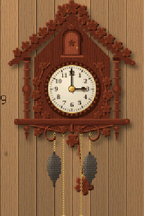
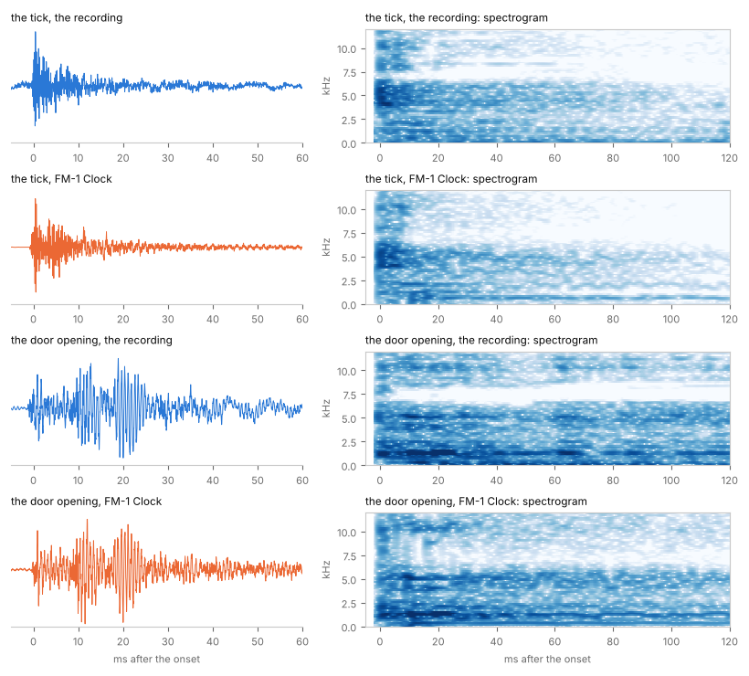

# The cuckoo clock

[Back to the README](../README.md) · [The sound](SOUND.md) · [How it works](HOW-IT-WORKS.md)

Turn ALGORITHM and the wall clock gives way to a cuckoo clock, the other kind of clock everybody can hear in their
head. It shares the time, the panel and the engine with the wall clock; its picture, its motion and its sound are
its own.

## Its own design

The house is this firmware's own, drawn by code (`tools/gen_art_cuckoo.py`) and not taken from any real clock or
photograph: a painted Black Forest chalet.

- A roof of shingles on a thick edge, a scalloped barge board under them, a turned finial at the peak.
- The bird's door in the gable: an arched board with a heart cut through it and a brass knob.
- A big cream dial, 62 px across, with Arabic numerals, a minute track and a carved bezel with a brass bead. A real
  cuckoo clock's dial is small; on a 240 px screen it has to be bigger to be read. The hands are the wall clock's,
  smaller, dark on cream.
- Two windows with green slatted shutters and red geraniums in their flower boxes.
- A balcony of eighteen sawn boards, a round hole and a slot cut where every other two meet, as on the chalets of
  the Black Forest.
- A carved apron under it, scalloped, with a heart for a drop.

Everything is drawn eight times over (polygons, ellipses, and wood grain made from smoothed noise, the boards'
grain vertical, the beams' horizontal) and averaged down to the screen, so the edges are soft. The house is
stored once (138 × 166 px); what moves is drawn by the firmware from sprites made at the same time
(`firmware/gen/clk_art_cuckoo.h`).

## What moves

- **The pendulum** hangs from behind the dial: a wooden stick, and a bob that is a wooden disc with a brass rim and
  an edelweiss. It swings 7° each way, one beat every 0.4286 s, a tick at each end. On a cuckoo clock the pendulum
  hangs close to the wall, **behind the chains**, and so it is drawn: its stick and its bob, the bob turned with
  the stick and sampled between pixels so it glides, then the chains, the weights and the rings over it, then the
  house's balcony and apron over all of it.
- **The chains run.** Each strand is drawn link by link (a link face on, the next edge on), and the links move as
  the chain does: down on the weight's side, up on the ring's.
- **The weights go down** (see below): the going weight steadily, about a pixel every 23 minutes; the cuckoo's
  weight in a step at each call, its chain running for the time of the call. Both reach the bottom after about a
  day, and then somebody winds the clock (as one does a 1-day cuckoo clock every morning): the rings are pulled
  down, the weights come up, one chain and then the other, the click wheel clicking. ENV does it whenever you like.
- **The door and the bird.** With the train's release click, 0.4 s before the first call, the door opens:
  it turns about its hinge in perspective, its free edge growing as it comes towards you, edge on at 90°, its
  darker back against the gable at 150°. Then the bird comes forward out of the dark doorway: it grows from 55 %
  of its size to all of it and is lit as it comes out, on its perch. On each call it **bows** (17° forward) from
  its high note to the end of its low one, and **opens its beak** on each note. After the last call it goes in and
  the door shuts on the last click. The bird is drawn at twice the screen's resolution, in two poses (beak shut,
  beak open), and scaled and turned as it moves, 2 × 2 samples to a pixel.
- **The half hour**: one call. **Silent** (FX): no gong, no pipes, the door stays shut.

## The chains and the weights: not a counterweight

The chains that hang under a cuckoo clock, and move, look as if they could be a counterweight. They are not: **the
weights are the clock's engine**, and the chains are how you wind it.

- **The weights drive the clock.** A mechanical cuckoo clock has no spring. Each weight (traditionally a cast iron
  pine cone) hangs on a chain that is wrapped round a **sprocket wheel** inside the movement. As the weight sinks,
  it turns the sprocket, and the sprocket turns the wheels.
- **One weight per job.** A 1-day clock has two: one drives the **going train** (the time: the wheels, the hands,
  the escapement that the pendulum lets go one tooth at each tick), the other drives the **striking train** (the
  cuckoo: the bellows, the bird, the door, the gong's hammer), which only runs when it calls. A clock with a music
  box has a third. (Which side is which varies from maker to maker; on this one the time is on the left.)
- **The other end of each chain is the winding handle.** The chain runs over the sprocket and its other end hangs
  free, with a ring on it. Pulling the ring down lifts the weight; a click wheel (a ratchet) lets the sprocket turn
  backwards only for winding, which is the clicking you hear. So as a weight sinks through the day, **its chain's
  free end rises**: that is the movement you see. The ring's own small weight keeps the loose end taut, so it does
  not slip off the sprocket or tangle; it is not there to balance anything.
- **1 day, 8 days.** A 1-day movement runs about 24 to 30 hours on one winding and is wound every day. An 8-day
  movement has heavier weights and longer chains and is wound once a week.

The firmware does all of this: the going weight sinks with the time, the cuckoo weight with the calls, each ring
rises as its weight falls (one chain, so the sum of the two is fixed), and winding pulls them back.

Sources: [How do cuckoo clocks work (German Clocks and Gifts)](https://germanclocksandgifts.com/a/answers/4940323/how-do-cuckoo-clocks-work),
[Do the pine cones move down](https://germanclocksandgifts.com/a/answers/5395120/Do-the-pine-cones-move-down),
[How Do Cuckoo Clocks Work? (cuckooclocks.com)](https://www.cuckooclocks.com/blog2.asp),
[What Is a 1 Day Cuckoo Clock?](https://www.cuckooclocks.com/blog12.asp),
[Cuckoo clock (Wikipedia)](https://en.wikipedia.org/wiki/Cuckoo_clock).

## Its sound

The sound is fitted, as the wall clock's is, to a recording of a real clock: a small carved 1-day Black Forest
cuckoo clock, made in Germany, ticking, calling the half hour and then ten o'clock. The recording is not in this
repository; its measurements are (`tools/ref_cuckoo.json`, `tests/ref/cuckoo_features.json`, made by
`tools/analyze_cuckoo.py`), and the model fitted to them (`tools/clk_cuckoo.json`, by `tools/fit_cuckoo.py`).

- **The wire gong.** A cuckoo clock strikes a wire gong at each call, the hammer driven by the same train as the
  bellows. Its modes are measured from the half hour's single call, as the wall clock's are (matrix pencil, per
  70 Hz band, from 80 Hz). The pipes start 0.22 s after the hit, so in the bands round their pitches only the
  0.17 s before them can be used; elsewhere 0.75 s. **681 modes**, every one an FM carrier; the 32 strongest with
  a modulator for the hammer's attack, searched as the wall clock's so that its first 140 ms match: 5.4 dB off
  before the search, 1.7 dB after. Then each third of an octave's decays are stretched (up to four times, round the
  pipes' pitches, where 0.17 s was too short to see the slow modes) so that a call in the train, with the two
  before it still ringing and its pipes sounding, has the recording's energy, while the lone hit keeps its own.
- **The two pipes.** The cuckoo's call comes from two small wooden organ pipes, each blown by its own bellows that
  the striking train lifts and lets fall. Here they are **1223.9 Hz** ("cu") and **997.6 Hz** ("ckoo"): 354 cents
  apart, between a minor and a major third. Each pipe is an FM pair at its pitch (carrier and modulator 1 : 1),
  its index set from the recording's second harmonic (30 dB under the note: an index of 0.06, a nearly pure,
  flutey tone), with the partials of its body that the recording shows (the low pipe's bellows and box: 297, 374,
  820 and 2068 Hz), and its envelope **as the bellows breathe it in the recording**, measured in steps of 16
  frames: 0.23 s and 0.20 s, then carried on down with an 80 ms fall, under the gong.
- **The calls.** The hammer hits; the high pipe sounds 0.11 s later (0.22 s on the first call, the train getting
  going), the low pipe 0.19 s after it; a call every 0.665 s, each varied by about ±1 %, as the recording's are.
- **Before the bird comes out**, as in the recording. At the hour the striking train is let go and runs: it
  rattles (below), and clicks twice, 0.75 and 0.66 s before the first call. 0.55 s before it, it catches on its
  warning pin and stops; only the pendulum ticks on. 0.40 s before it, the release: a click, the door opens, and the
  train runs again, rattling, until the door shuts after the last call (the bird goes in on one click, the door
  shuts on another). The first blow comes 0.87 s after the hour.
- **The mechanism's clicks are each its own sound**: the warning clicks; the door opening, the latch letting go and
  the door swinging to its stop, its wood (1.2–1.4 kHz, and 4–5 kHz) struck three times in 20 ms, 20 to 30 dB
  louder than a tick in the middle; and the door shutting, one sharp impact. The bird going in sounds on the low
  pipe's note, so its own sound cannot be measured; above 3 kHz, where the pipe is quiet, it is as loud as the door
  shutting, and that is its sound. The tick goes on through all of it: each click is one sound in one of the two
  banks, so the next tick has the other.
- **The rattle.** While the train runs, its wheels and its fly rattle: an irregular click every 2 to 10 ms, 1.2
  to 1.4 kHz the strongest, and 0.8–1 kHz, 2 kHz and 4.7–5.2 kHz, as loud above 800 Hz as a tick. In the firmware
  it is clicks at random, 250 a second, each a sine at one of the ten measured frequencies (as often as its share of
  the power), 0.4 to 1 of the full level, ringing 1.5 ms: eight operators, computed all the time.
- **A click is not a chord** (`tools/clicks.py`). Held side by side with the recording, waveform and spectrogram,
  an earlier fit (a sine for every twelfth of an octave, each with its own decay) was right band by band in energy
  and wrong in kind: its spectrogram was horizontal lines, steady tones at 0.6, 1.2, 2.0 and 2.1 kHz ringing for
  160 ms, a resonator, a small bell. The recording's tick is a crack and a burst of noise. Lined up and averaged
  sample by sample, its ticks show what comes back every time: in the first 2 ms at 3–8 kHz about half of it (the
  escapement's crack), after 5 ms next to nothing, at any frequency. So a click is two things now:
  - **What comes back every time, as it is.** The tick's crack, 13 modes at 2.3–6.5 kHz, and its case's knock, 8
    modes at 98–428 Hz, from seven ticks lined up and averaged (matrix pencil, then frequencies and decays refined
    together, levels and phases by least squares; under 400 Hz the room is as loud as the tick, but the knock comes
    back with every tick and the room does not, and the knock is set as loud as the average has it over its floor).
    The door's wood: 12 damped sines, each struck at its own moment (matching pursuit on the one door: 90 % of it at
    1.0–1.7 kHz, 70 % at 3.8–5.6 kHz). These play the same every time, phase and all.
  - **The rest is noise.** Operators that each fill a band instead of drawing a line: each takes another
    frequency within its band every few steps of the engine's 16 frames (as often as noise that wide changes), its
    phase unbroken. An eighth of an octave wide, or half an octave for whatever lasts longer than 11 ms (a narrow
    band that lasts is a whistle). Each starts on its own step, up to 25 ms in. Their levels are fitted to the
    click's power over time in two grids at once: in eighths of an octave over eight windows to 130 ms (its colour)
    and in octaves over 1 ms windows (its time: the crack's rise, the door's three blows). The error is squared in
    dB, too loud as bad as too quiet, and every window and band counts only as far as it stands over the floor (the
    quiet before the click). From every band, decay (0.7 to 40 ms) and start, the least used are dropped until 68
    are left (47 for the tick, beside its 21 modes).
  - The power is measured through smooth bands (cos² on a log axis), so a band does not ring as a brick-wall one
    does, on the recording and on the engine's operators, rendered as the engine plays them, alike.
  - **How much like noise**: the spectral flatness, the spectrum's geometric mean over its arithmetic mean (white
    noise about 0.56, a few steady tones near 0), in four bands from 0.5 to 14 kHz and three windows to 120 ms,
    where the tick stands over the room. The recording's tick: 0.13 to 0.46. The earlier one: 0.01 to 0.32, and
    0.05 and under above 3 kHz. FM1 Clock's now: 0.24 to 0.46.

- **The train's drone.** Under its rattle the running train whirs: 70 and 75 Hz the loudest, a little at 93, 155
  and 248 Hz, and a comb from 283 to 439 Hz with its partials about 12.6 Hz apart, which beats. In the recording it
  is the loudest thing below 100 Hz, and much of the cuckoo's depth. Its 12 partials are found in the train running
  before the first call (no gong and no pipe yet), at most three in a third of an octave; their levels from each
  third's power, the train running less the train still, over stretches with no click, no door and no gong in
  them. (An earlier measurement had the door's ring and the warning clicks in its stretches, and a band so narrow
  that it smeared the first blow back over the stretch before it: the comb came out 12 to 16 dB too loud, a rasp
  under the calls.) They sound whenever the train runs, up in 60 ms, down in 100 ms: 12 sine operators, computed
  all the time.
- **Winding** is the click wheel: the tick's sound, softer, every 84 ms while the chains are pulled.
- **All of it at once.** The engine holds one clock's operators at a time. When ALGORITHM changes the clock, the
  interrupt loads the other one's gong into the same carriers (all still), and its governor carries on. The pipes
  are computed in every frame for both clocks, sounding or not, as everything else is.

## How close the cuckoo is

Measured as the wall clock's is (`tests/clk/parity.py`): the difference from the recording in every third of an
octave, the root mean square over the bands that stand 6 dB over the recording's noise, in dB.

| The wire gong, one hit | 0–10 ms | 10–30 | 30–70 | 70–140 |
|---|---|---|---|---|
| all 681 carriers | 1.23 dB | 1.76 | 2.40 | 3.09 |
| 206 carriers (as on the chip) | 1.69 dB | 3.43 | 3.31 | 5.24 |

| A call, the mean of nine | 0–20 ms | 20–60 | 60–140 | 0.14–0.22 s | 0.22–0.3 | 0.3–0.4 | 0.4–0.5 | 0.5–0.6 |
|---|---|---|---|---|---|---|---|---|
| all 681 carriers | 5.01 dB | 4.73 | 3.92 | 4.49 | 3.92 | 4.30 | 3.49 | 6.70 |
| 206 carriers (as on the chip) | 5.01 dB | 5.43 | 4.69 | 4.84 | 3.53 | 5.08 | 4.49 | 7.73 |

| The mean of 24 | −2–4 ms | 4–10 | 10–20 | 20–35 | 35–60 | 60–90 |
|---|---|---|---|---|---|---|
| ticks (above 400 Hz, in thirds of an octave) | 4.50 dB | 3.13 | 4.39 | 3.15 | 5.00 | 4.29 |

The clicks as measured (`tests/ref/cuckoo_clicks.json`), in eighths of an octave, every window, over the bands
6 dB over the floor; and in octaves over 1 ms windows to 120 ms, the root mean square of those windows (and the
worst):

| | −1–2 ms | 2–5 | 5–10 | 10–18 | 18–30 | 30–50 | 50–80 | 80–130 | 1 ms windows |
|---|---|---|---|---|---|---|---|---|---|
| the tick (24) | 2.51 dB | 2.34 | 1.79 | 1.77 | 2.19 | 2.93 | 2.60 | | 1.36 (2.60) |
| the warning click | 3.39 | 2.65 | 2.46 | 2.75 | 2.73 | 2.65 | | | 2.27 (4.43) |
| the door opening | 4.43 | 4.32 | 5.36 | 4.30 | 4.26 | 5.19 | 5.13 | 5.46 | 2.48 (4.23) |
| the door shutting | 4.05 | 2.79 | 2.48 | 2.01 | 2.91 | 3.14 | 2.23 | 4.56 | 1.79 (2.72) |

The case's knock (80–450 Hz, its first 80 ms) is within 0.7 dB of the recording's, the running train's drone
(56–447 Hz) within 0.1 dB and its rattle (above 800 Hz) within 0.3 dB.

The recording has five clean ticks, three warning clicks, one door opening and two door shuttings: in eighths of an
octave a single click differs from the next by a few dB a band (and the one door, a single noise, by about 5), and
that is about what is left. The calls are
not as close as the
wall clock's gong: the recording's calls overlap (a pipe is still breathing out and the gong still ringing when the
next call starts), and the gong could be watched for only 0.17 s round the pipes' pitches. The running train's
rattle filled much of what was missing between the calls: the last tenth of a second before the next call, 8 dB
dry without it, is within about 7 dB now (the drone, 12 to 16 dB too loud before, is as the recording has it).
On the chip the governor renders 206 of the wire gong's 681 carriers (97.5 % of its energy; the wall clock's 206
hold 99.6 % of its gong's), and what it leaves out is the weak, long-ringing modes, so the lone gong's tail is a
little drier there: that is what the case's knock, the clicks' noise, the train's drone and its rattle cost, which
are computed all the time. The calls, with the rattle under them, are closer on the chip than they were without it.
