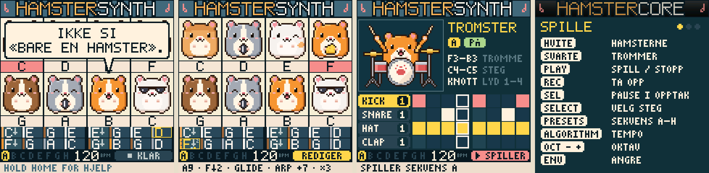

# Hamster Piano for M-VAVE FM-1

Nettsiden *Hamster Piano* (v4.17) som firmware for FM-1: de åtte hamsterne, 16-stegs sequenceren med fire sekvenser
og song, Tromster og THALLHAMSTERGRINDCORE. Den bygger på samme plattform som FM-1 Clock (Dinghy 0.5) og ligger i
samme repo som en egen app: `firmware/src/hamster.c`.

<p align="center"></p>

> [!CAUTION]
> **Ikke prøvd på en ekte FM-1 ennå.** Bygget med JieLi-verktøykjeden, testet på vertsmaskin og kjørt i fm1-emu
> (FM-1-emulatoren), men ikke på en fysisk enhet. Installer på eget ansvar. Går noe galt: hold **OCT−** mens du slår
> på, så starter FM-1 i USB-redning, der en installer alltid virker.

**Hør den:** [hamster-demo.mp3](hamster-demo.mp3) (49 s). Hamsterne én og én, trommene for hånd, sekvens A,
Tromster, en song på fire sekvenser og THALLHAMSTERGRINDCORE. Det er firmwarens egen kode som spiller, kjørt på en
datamaskin: `sh tools/ham_demo.sh` lager den på nytt, også som video med skjermen (`build/demo/`).

## Bygge og installere

```sh
./build.sh --app hamster                           # -> build/hamsterpiano.fwsc (identitet FM-1_902)
python3 tools/fm1_install.py build/hamsterpiano.fwsc   # spør før den skriver
sh tests/run_hamster.sh                            # testene på vertsmaskin (Python med numpy og Pillow)
sh tools/emu_hamster.sh                            # pakken i fm1-emu
```

CI bygger pakken på hver push (artefaktet `packages`). SMK-37: `./build.sh --app hamster --board smk37`.

## Slik spiller du

| | |
|---|---|
| **Hvite tangenter** | Hamsterne. C4–C5 er de åtte; F3–B3 er de samme en oktav ned, D5–G5 en oktav opp. |
| **Svarte tangenter** | C#4 D#4 F#4 G#4: kick, snare, hat, clap for hånd. |
| **PLAY** | Spill / stopp (sekvensen, eller songen når SONG er på). |
| **REC** | Stegopptak: hamsteren lagres i steget og går videre. **SEL** legger inn pause. |
| **EDIT** | Rediger: en tangent bytter tonen uten å gå videre. **SELECT** velger steg. |
| **SELECT** | Velg steg (og hør det). |
| **PRESETS** | Sekvens A–D. Mens den spiller: byttes ved neste runde. |
| **ALGORITHM** | Tempo, 50–220 BPM. |
| **OCT− / OCT+** | Tangentene en oktav ned / opp (i EDIT: stegets oktav, −3 … +1). |
| **ENV** | Angre (12 nivåer). |
| **SEQ** | Tromster-siden (og trommene på). Hold: trommer av / på. |
| **FX** | THALLHAMSTERGRINDCORE av / på: −1 oktav, vreng, dobbelt tempo. Hold: hamsterstemmen eller sidens stemme. |
| **GLO** | SONG av / på. Hold: siden for song-rekkefølgen. |
| **HOME** | Hjem. Hjemme: skiltet sier noe nytt. Hold: hjelp på skjermen. |
| **SEL** (hold) | Slett sekvensen (ENV henter den tilbake). |
| **SAVE** | Lagre nå. (Den lagrer også selv, to sekunder etter siste endring, når ingenting låter.) |
| **KNOTT 1–4** | Swing, hamsternivå, Tromster-nivå, MIDI-kanal. |

**I EDIT:** KNOTT 1 glide, KNOTT 2 arp (+7, +12), KNOTT 3 accent, KNOTT 4 ratchet (×1–×4). **ARP** blar også arp,
**SEL** sletter steget, **SAVE** kopierer det til neste, **LFO** lager en tilfeldig sekvens.

**På Tromster-siden:** F3 G3 A3 B3 velger kick, snare, hat, clap; C4–C5 setter de åtte stegene (lysene viser dem);
KNOTT 1–4 velger lyd 1–4 for hver tromme (1–3 er sidens, 4 er hamstersettet: kinnpop, frøknas, snus og pip); hold SEL
sletter raden.

**På song-siden:** C4 D4 E4 F4 skriver A B C D ved markøren, SELECT flytter den, PRESETS bytter bokstaven, SEL sletter.

**Stegene på skjermen:** tonen, piler for oktav, og små merker nederst: blå = glide, gul = arp (bred = +12),
rosa = accent, oransje prikker = ratchet.

**Lys:** de åtte hamstertangentene gløder, den som synger lyser. PLAY blunker på slaget; REC, EDIT, SEQ (trommer på),
FX (THALL) og GLO (SONG) lyser når de er på.

## Valg som er tatt for FM-1

- **Tangentene bærer oktaven.** Siden har åtte knapper og egne oktavknapper per steg. FM-1 har 16 hvite tangenter, så
  de ytterste spiller de samme hamsterne en oktav ned og opp, og oktaven følger med inn i steget.
- **Stegeffektene er alltid tilgjengelige.** På siden vises glide, arp, accent og oktav bare i THALL-modus; her ligger
  de på knottene i EDIT uansett.
- **Sequenceren teller lydrammer**, ikke en nettlesertimer: et steg er 30 / BPM sekunder på rammen, ratchets på sine
  delinger.
- **Sekvensbytte mens det spiller** skjer ved neste runde i stedet for å stoppe.
- **WAV-eksport** er USB-lyden: FM-1 dukker opp som lydinngang (44,1 / 48 kHz), ta opp det den spiller.
- **Nytt:** trommer for hånd på svarte tangenter, swing, egne nivåer for hamstere og Tromster, MIDI inn (noter,
  klokke, start / stopp) og ut (hamsterne på valgt kanal, trommene på kanal 10), alt lagres i flash.

## Figurene

Hamsterne og trommehamsteren er tegnet på nytt som pikselkunst i `tools/ham_sprites.py`, med samme kjennetegn som på
siden: den gylne, den grå med solsikkefrø, den hvite som blunker, den oransje med ost, den brune, den grå som smiler
med lukkede øyne, den oransje med tunga ute og den hvite med solbriller. Én blekkfarge for omrisset og lys fra øvre
venstre hjørne. Hver figurpiksel er 2×2 skjermpiksler, som logoen og teksten.

## Hamsterstemmen

Standardstemmen er firmwarens egen, mer hamstrete enn sidens (hold **FX** for å bytte til sidens):

- **Hver tone piper:** den starter med et lite kvitter ovenfra og vokalen «i», synger sin egen vokal og lukker seg
  med «u», litt lavere.
- **Hver hamster har sin stemme:** størrelse (formantene), vokal, trille og hvor mye den piper. Den hvite piper mest,
  den brune er dypest, den med ost har munnen full, den med solbriller er kul og rolig.
- **Rikere klang:** opptil 24 overtoner i stedet for 8, så de små hamsterstrupenes høye formanter høres.
- **Ryddigere:** tonens lengde følger tempoet, så raske sekvenser ikke flyter sammen. Hamsterne sitter fra venstre til
  høyre i stereo, slik de sitter på skjermen, i et lite rom med noen få refleksjoner.
- **Hamstersettet** i Tromster (lyd 4 på hver tromme): kinnpop, et frø som knaser, et snus og et pip.

Lyddemoen bruker hamsterstemmen. `tools/ham_demo.sh` lager også samme demo med sidens stemme
(`build/demo/hamsterpiano-demo-side.mp3`) til sammenligning.

## Sidens stemme

Siden bygger hver tone av Web Audio-noder. Her, i heltall (`firmware/src/ham_engine.h`):

- **En hamster** er en bølgetabell med de åtte overtonene slik de tre formantfiltrene og lavpassfilteret etterlater
  dem på akkurat den tonen (`tools/gen_ham_tables.py` regner filtrene ut, én tabell per tone), kroppens sinus ved
  siden av, pust (filtrert støy) og rommets ekko. Under glide regnes hver overtone gjennom formantene der den er.
- **THALL** går gjennom sidens forvrengning (kurven, fire ganger oversamplet) og kabinettfiltrene, én stemme om gangen.
- **Tromster**: kick, snare, hat og clap med tre lyder hver.
- Omhyllingskurvene er linjer i logaritmen, altså Web Audios eksponentielle ramper.

Sidens stemme er beholdt som den var. Mot sidens egen gjengivelse (`tools/ham_ref.js` lar siden rendre testtilfellene; `tests/ham/parity.py` sammenligner
energien i tersbånd over tid): hamsterne innenfor ca. 0,2–0,5 dB i snitt, THALL 0,4–0,6 dB, trommene ca. 1,4 dB
(støy er aldri lik to ganger). Referansen er instrumentet slik det spilles live: sidens WAV-eksport starter noter
midt i en lydblokk, og da begynner Chromiums oscillatorer på feil tonehøyde et øyeblikk, som endrer forvrengningen i
THALL. Den særheten er ikke portet.

Hamsterstemmen testes for nivå (like sterk som sidens innenfor 2 dB) og at ingenting klipper. I fm1-emu bruker
lydavbruddet på det meste ca. 22 % av tiden det har.

## Hva er hvor

| | |
|---|---|
| `firmware/src/hamster.c` | Appen: tangenter, knapper, sider, lagring, MIDI |
| `firmware/src/ham_engine.h` | Lyden og sequenceren (lydavbruddet) |
| `firmware/src/ham_draw.h` | Skjermen |
| `firmware/gen/ham_tables.h`, `ham_art.h` | Laget av `tools/gen_ham_tables.py` og `tools/gen_ham_art.py` (`--sheet FIL.png` viser alle figurene) |
| `tools/ham_sprites.py` | Hamsterne og trommehamsteren, tegnet piksel for piksel (26×27 og 56×45, vist 2×2) |
| `tests/run_hamster.sh`, `tests/ham/`, `tools/emu_hamster.sh` | Testene |
| `tools/ham_demo.sh`, `tests/scripts/ham/demo.txt`, `tests/ham/demo_song.h` | Lyddemoen: hva som trykkes når, og sangen den spiller (bare i demobygget) |
