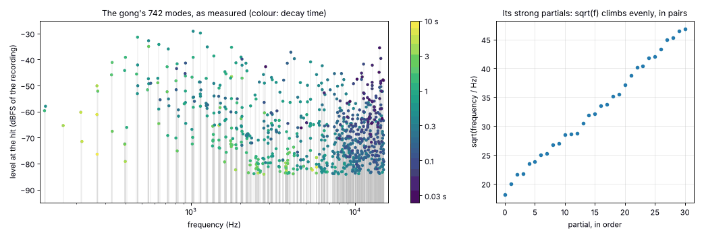
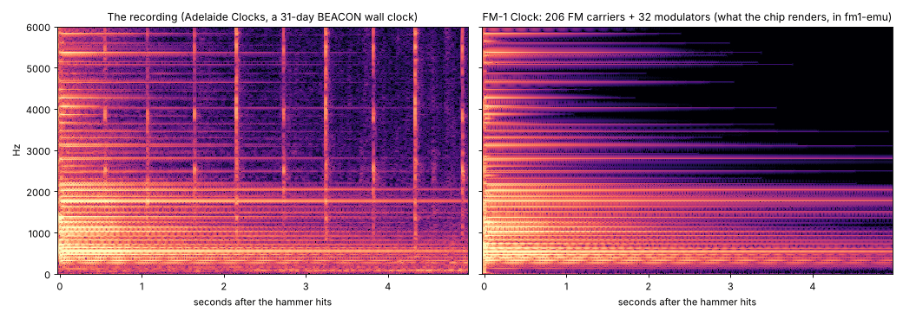

# The sound, and the engine

[Back to the README](../README.md) · [The cuckoo clock](CUCKOO.md) · [How it works](HOW-IT-WORKS.md)

Everything you hear is synthesised. No sample of the recording is in the firmware.

## The recording

*Clock Strike Chime Sound 31x Day BEACON Pendulum Wall Item 1125*, by Adelaide Clocks: 48 kHz, mono, 43 seconds,
low-passed at about 15.5 kHz. It is not in this repository (it is not ours to share). What is here are measurements
of it (`tools/ref_model.json`, `tests/ref/features.json`), made by `tools/analyze_ref.py`.

| Time | What is in it |
|---|---|
| 0–15.5 s | The clock ticking. Its tick and tock come 0.578 s and 0.511 s apart in turn: that clock is a little out of beat. FM-1 Clock ticks evenly, every 0.5 s. |
| 15.65 s | **One strike, on its own** (a half hour). This is what the gong's model is measured from. |
| 25.6–37.5 s | **Eleven strikes** (eleven o'clock), 1.192 s apart. This is what the strike train is measured from. |

## The coil gong

A wall clock's "gong" is a coil of hardened steel wire, fixed at one end in a block on the back of the case. Struck
by a hammer, the wire bends and vibrates in many modes at once, each with its own frequency, and each one dies away
at its own rate: that is the gong's sound.

The measurement shows exactly that. The strong partials come in **two nearly equal series**: 267/270 Hz, 328/331,
394/398, 466/472, 543/551, 628/637, 716/727, 810/823 and on up. A wire coiled in a spiral bends a little differently
in its two directions, so each mode comes twice, a few hertz apart, and **the two beat against each other**: the
slow shimmer you hear while the gong rings. Within each series **the square root of the frequency climbs in even
steps** (about 1.76 √Hz a partial). That is how the bending modes of a stiff bar or wire are spaced (their
frequency grows with the square of their number), and not how a string or a pipe is spaced (they grow in
whole-number steps). That is why a gong sounds like a gong and not like a note.

## Measuring the modes

A ringing mode is a *damped sinusoid*: a frequency, a level, a phase, and a decay (the level falls by e, about
8.7 dB, every τ seconds). The analysis finds all of them, like this:

1. **The hit.** The strike's exact moment is found in the recording (15.6503 s), and the window 0.06–5.2 s after it
   is taken: after the hammer's first crash, before the room's noise at 22 s.
2. **Bands.** For every 70 Hz from 150 Hz to 15 kHz, the signal is shifted down so that the band's centre sits at
   0 Hz (multiplied by a complex sinusoid), low-passed, and kept at only 400 samples a second. Each band is now a
   short, slow signal holding just the few modes within 35 Hz of its centre.
3. **Matrix pencil.** Each band is analysed with the *matrix pencil* method. A signal that is a sum of damped
   sinusoids has a special structure: shifted by one sample, it is the same sum with each sinusoid multiplied by a
   fixed complex number (its *pole*, which holds its frequency and its decay). The method stacks the signal into a
   matrix of shifted copies, finds the few directions that carry it (a singular value decomposition, keeping what
   is less than 45 dB under the strongest), and solves for the poles directly. Then the levels and phases follow by
   least squares. No guessing, no peak picking.
4. **What is kept.** The bands tile the spectrum, so no mode is found twice. 742 modes are kept, from 128 Hz to
   15 kHz. Many partials turn out to be **two poles at almost the same frequency with different decays**, for
   example the strongest, 551.4 Hz, falls with τ = 0.39 s and with τ = 2.1 s at once: a partial that drops quickly
   after the hit and then rings on. Both are kept.
5. **The tail.** The fit leans on the loud beginning. So afterwards, the decay times in each third of an octave are
   stretched a little (by 0.89–1.34) until the band's energy from 0.1 to 5 s matches the recording too.
6. **The ticks during the decay.** The recording keeps ticking while the gong rings. The analysis finds those ticks
   (above 8 kHz the gong is quiet after 0.2 s) and leaves them out of every measurement of the gong.

## From modes to FM

**FM synthesis** makes sound from *operators*: sine oscillators. A *carrier* is an operator you hear. A
*modulator* is an operator you do not hear: it pushes the carrier's phase back and forth. How far it pushes is the
*index*. With the index at zero the carrier is a pure sine. As the index rises, the carrier's energy spreads out
into *sidebands* above and below it, spaced by the modulator's frequency, and the sound gets brighter and harsher.
A classic FM bell uses a handful of operators at strange ratios and lets the index fall after the attack.

FM-1 Clock does the same thing, at a much larger scale:

- **Every measured mode is a carrier**, at its own frequency, level, phase and decay: up to 742 carriers.
- **The 32 strongest have a modulator each.** Their index is high at the moment the hammer hits and falls within
  milliseconds, so that for an instant each of them spreads into sidebands: the crash of the hammer on the steel.
  A carrier's level may also be lifted for that moment. Each of the 32 is, in effect,

  `a · e^(−t/τ) · (1 + B·e^(−t/τI)) · sin(2πft + φ + I·e^(−t/τI) · sin(2π·r·f·t))`

  with its ratio *r* (from 0.1 to π), its index *I* (0 to 3 radians), the index's fall *τI* (4 to 60 ms) and the
  lift *B* chosen by searching (`tools/fit_model.py`: each operator in turn, every combination, three rounds), so
  that the first 100 ms have the recording's energy in every third of an octave. Before the search those first
  100 ms were 2.4 dB off on average; after it, 0.9 dB.

## The strike train

- **Timing.** The hammer strikes 1.192 s from blow to blow, as in the recording, varied by about ±1 % (±12 ms) from
  blow to blow, as a real clock's train is.
- **Strength.** Every blow is as hard as the first, varied by up to ±6 % from blow to blow. The recording's eleven
  strikes do get softer after the first two (0.85, then about 0.53 of the first, measured as the energy just after
  each blow minus the energy just before), but only because the phone recording them was moved further from the
  clock, so here they are balanced.
- **The release click.** About 40 ms before each blow there is a click: the strike train letting the hammer go. It
  is one of the tick sounds, softer.
- **A blow on a ringing gong.** A new blow adds to a gong that is still ringing. Each mode's new level is the sum of
  the old one and the new one with the phase between them unknown (|a + b| ≈ the larger + 3/8 of the smaller). If
  the gong is (almost) still, each mode starts from the phase it had in the recording, so a blow from rest is the
  recorded blow.

## The tick and the tock

The recording's 14 ticks and 14 tocks were lined up and measured separately (above 400 Hz; there is a hum in the
room below that). Each of the two sounds is rebuilt from **64 sine operators**:

- **The frequencies:** the 28 strongest peaks of its spectrum (the escapement's steel ringing, around 1.4, 1.8, 2.3,
  2.5 and 3.7 kHz), and 36 more spread from 330 Hz to 14.5 kHz to fill in between (the wooden case knocks too).
- **Two decays in every third of an octave:** the operators there take a short and a long decay in turn (the
  click falls fast, then the movement and the case ring on). Each band's two decays are picked from a grid by
  non-negative least squares against the recording's energy in that band over its first 35 ms.
- **The levels, all at once:** a window of a few milliseconds smears each operator's energy into the neighbouring
  bands, so all 64 levels are then fitted together, each operator with its own template (non-negative matrix
  factorisation updates).
- **The rise:** a tick is not instant. It rises as 1 − e^(−t/τa): τa = 4.0 ms for the tick, 5.5 ms for the tock.
- **No two alike:** each tick starts every operator at a random phase, a little off in pitch (±0.1 %) and level
  (±12 %), and the whole tick 0.92–1.04 of its level.
- **Where it comes from:** the tick is 4.6 dB louder on the left, the tock on the right.
- **One click on each side.** The recording has a softer second click 115 ms after each tock (the escape wheel
  settling). On the clock it made the tock sound double, so it is gone.

## How close it is

The engine is run on its own on a computer (`tests/clk/clk_render.c`, the firmware's own code), and its output is
measured the way the recording was: the energy in each third of an octave, 100 Hz to 16 kHz, in windows of time
after the hit, with the recording's ticks masked out and only the bands where the recording stands 6 dB over its
noise counted. The numbers are the root mean square of the differences over the bands, in dB
(`tests/clk/parity.py`).

| A strike | 0–20 ms | 20–50 | 50–100 | 0.1–0.2 s | 0.2–0.4 | 0.4–0.8 | 0.8–1.6 | 1.6–3.2 | 3.2–5 |
|---|---|---|---|---|---|---|---|---|---|
| all 742 carriers | 0.66 dB | 1.31 | 0.65 | 0.69 | 0.62 | 1.02 | 1.17 | 0.72 | 1.78 |
| 206 carriers (as on the chip) | 0.56 dB | 1.01 | 0.84 | 0.84 | 0.71 | 1.33 | 1.54 | 0.70 | 1.80 |
| 160 carriers | 0.53 dB | 0.98 | 0.94 | 1.16 | 0.86 | 1.73 | 1.59 | 0.70 | 1.86 |

| The mean of 24 | −2–4 ms | 4–10 | 10–20 | 20–35 |
|---|---|---|---|---|
| ticks | 1.31 dB | 0.93 | 1.15 | 1.23 |
| tocks | 0.95 dB | 0.96 | 1.15 | 1.16 |

A difference of 1 dB in a band is about the smallest change of loudness most people can hear.

## Using the whole chip

- **Every operator is computed in every frame, sounding or not.** Between the strikes the gong's carriers are
  still there, at a level of zero, and they still cost what they cost; so are the cuckoo's two pipes, even while
  the wall clock is showing. That is the point: the chip is full all of the time.
- **A governor keeps it full and no fuller.** It measures each audio block's render against the crystal and
  renders as many of the gong's carriers (the strongest first, by their energy a²τ) as fit in **78 %** of the time
  a block has (256 frames, 5.8 ms). It cuts by up to a quarter at once if a block runs long, and adds back at most 8
  carriers a block.
- **Nothing is lost when it adapts.** The carriers it leaves out keep ringing down and keep their phase going, so a
  carrier taken back in continues where it would have been.
- **It adapts to the real chip.** On a real FM-1 the governor settles wherever the chip really is. SEQ shows the
  number.
- **The updater gets the chip.** When an update starts, the sound stops, so the installer is never slowed down.

**Measured in fm1-emu** (the real package, in CI; the cuckoo clock while it calls, its pipes and its door
included):

| | The wall clock | The cuckoo clock |
|---|---|---|
| Gong carriers the governor renders | 206 of 742 (99.6 % of the gong's energy) | 206 of 681 (97.5 %) |
| FM operators in all | 402: 206 carriers, 32 modulators, 2 × 68 tick operators, the pipes' 8, the drone's 12, the rattle's 8, at 44.1 kHz | 402 |
| The engine's share of each audio block | 76.8 %, 77.9 % in the worst block | 77.2 %, 78.5 % in the worst block |
| All interrupts, of the whole chip | 75.2 % | 75.1 % (180.1 million instructions a second) |
| What is left | the pendulum at 50 frames a second, the hands, USB, the panel | the same, the door and the bird, the chains |

The two pipes (each a carrier and a modulator, the low one with four partials of its body) and the train's drone
(12 partials) and rattle (8) are computed for both clocks, all the time, and the tick banks have 68 operators each
(the cuckoo's knock), so the governor renders fewer of the gong's carriers than the 257 it rendered before the
cuckoo came.

On a computer the engine costs about 9.6 x86 instructions per carrier per frame and about 1470 per frame for the
two tick banks.

## The engine, in integers

The chip has no floating point unit, so everything is integers (`firmware/src/clk_engine.h`):

- **The sine** is a table of 16,384 values (Q15: −32,767 to 32,767) in RAM, made at power-on from a quarter wave
  in flash. An operator's phase is 32 bits, a full cycle being 2³², and its top 14 bits index the table.
- **A carrier** is four numbers: its phase, its phase step (frequency × 2³² / 44,100), its level (Q31 of full
  scale) and its decay, a multiplier applied every 16 frames (Q32). Its inner loop is: step the phase, look up the
  sine, multiply by the level, add.
- **A modulator** adds its own phase, step and index envelope. Its output, times the index, is added to the
  carrier's phase before the lookup: `SINT[(p + SINT[mp >> 18] · I) >> 18]`.
- **The tick banks**: two banks of 68 operators, so a tick can ring on while the next sound starts. Their levels
  step down every 4 frames (ticks fall fast) and their rise is applied every frame. The cuckoo's clicks use three
  kinds: a mode, the same every time (its phase from the table); noise, an operator that takes another frequency
  within its band every few steps of 16 frames, its phase unbroken; and either one starting late, on its own step,
  from nothing.
- **The mix** is in Q30 and is scaled by the two level knobs. The gong goes to both channels equally, each tick
  bank with its own left/right pan.
- **The levels:** the output is the recording's level × 2.3. A lone strike peaks at about 0.68 of full scale.
  Twelve blows at twelve o'clock, as the gong rings up and the ticks go on, peak at 0.82, so nothing clips.
